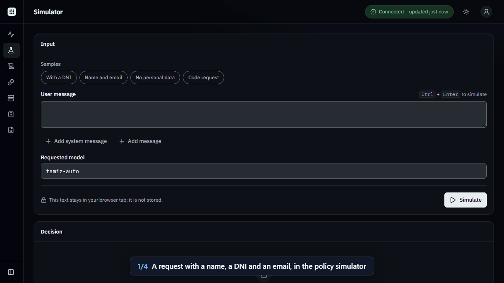
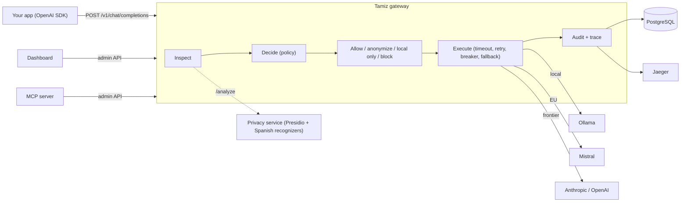

# Tamiz

[](https://github.com/AxelAxx/tamiz/actions/workflows/ci.yml)

**Privacy-aware LLM gateway.** Use the best model for every request without sensitive
data leaving where it belongs.



*A request with a patient's name, DNI and email. Tamiz finds all three, rates the request
critical and keeps it on the local model. The same request, sent through the gateway, is
answered by Ollama and audited: decision, entities and cost, never the text.*

## Why

Small European teams in health, legal, fintech and HR want to use LLMs, but they cannot
send personal data to any provider they like. Today they either keep AI away from that
data or use it without control. Tamiz is a self-hosted, OpenAI-compatible gateway that
sits between the application and the providers and makes that decision on every request:

1. **Inspects** each request for personal data: Spanish DNI, NIE, CIF, IBAN, NSS, cards,
   emails, phones, names and locations. That covers message text, tool-call arguments,
   tool results and tool definitions.
2. **Routes** it by a declarative YAML policy:
   - critical data stays on a local model (Ollama);
   - names, emails and phones leave only anonymized, and only to EU-resident or local
     targets;
   - everything else goes to the cheapest target that fits the task.
3. **Resists** provider failures with timeouts, retries, circuit breakers and fallback
   chains. A fallback that would break residency **blocks** instead of degrading.
4. **Audits** every decision (entities found, rule, target, cost, latency) in PostgreSQL
   and OpenTelemetry, without ever storing prompt content.
5. **Proves** it: privacy-leak, detection, routing, quality and agent evals run on every
   pull request with local models, and a result below its threshold blocks the merge
   (`evals` is a required check on `main`). A cost comparison is reported alongside.
   Results are [below](#evals).

Applications switch by changing the base URL and the API key of their OpenAI client.
Responses tell them what happened: `x-tamiz-route`, `x-tamiz-rule`, `x-tamiz-sensitivity`,
`x-tamiz-privacy`, `x-tamiz-fallback`.

## Quick start

**In the browser, nothing to install:** open the repository in GitHub Codespaces. The
codespace runs the whole stack below with a small local model, on your own free
Codespaces quota, and prints the dashboard's address and a generated passphrase
([details](docs/deploy.md#free-demo-github-codespaces)).

[](https://codespaces.new/AxelAxx/tamiz?quickstart=1)

**On your machine:** Docker with Compose v2.30 or later (for `env_file` with `format`),
about 15 GB of free disk (three images, the service images and the 5 GB local model), and
Node.js 22 with pnpm for the one-off secrets step:

```bash
git clone https://github.com/AxelAxx/tamiz.git && cd tamiz
pnpm install
pnpm compose:env        # asks for a dashboard passphrase, prints a client key and an admin key
docker compose up -d    # gateway, privacy, dashboard, postgres, valkey, ollama, jaeger
docker compose logs -f ollama-pull   # first start only: downloads llama3.1:8b (about 5 GB)
```

The first `up` builds three images (about six minutes, mostly the privacy service's
spaCy model). After that, the stack is healthy in about a minute, most of it the privacy
service loading its model. The model download comes on top, once.

`pnpm compose:env` writes `apps/gateway/.env.docker` and `apps/dashboard/.env.docker`
(git-ignored). The gateway starts on `apps/gateway/policies/local-only.yaml`, which needs
no cloud account. For the full routing policy:

1. set the Mistral, Anthropic and OpenAI keys in `apps/gateway/.env.docker`;
2. change `TAMIZ_POLICY_FILE` to `policies/default.yaml` (relative to `apps/gateway/`);
3. run `docker compose up -d gateway`.

Send a request with personal data, using the client key `pnpm compose:env` printed:

```bash
curl -s http://localhost:3000/v1/chat/completions \
  -H "authorization: Bearer tmz_..." -H "content-type: application/json" \
  -d '{"model":"tamiz-auto","messages":[{"role":"user","content":"Resume el expediente de 12345678Z."}]}' \
  -D - -o /dev/null | grep -i x-tamiz
```

```text
x-tamiz-privacy: restrict_to_local
x-tamiz-route: ollama-llama
x-tamiz-rule: default
x-tamiz-sensitivity: critical
```

Then look at the result:

| Where | What you see |
|---|---|
| Dashboard, http://localhost:3100 (your passphrase) | The request in live traffic and the audit log; the simulator, cost, provider health, eval results and the policy editor |
| Jaeger, http://localhost:16686 (service `tamiz-gateway`) | The `tamiz.request` span with the decision, a `chat llama3.1:8b` span with the GenAI attributes, and the privacy and routing events |
| MCP, [`apps/mcp-server`](apps/mcp-server/README.md) | The same data as tools for Claude Desktop, Claude Code or any MCP host (the `ops` admin key) |

## How it works



The routing decision is a pure domain function: it takes the policy and the request and
returns an ordered chain plus a privacy action. Everything with I/O sits behind ports,
which keeps the decision exhaustively testable (property-based tests included). The
gateway follows Clean Architecture, and dependency-cruiser fails CI on a layer violation.
Every public contract is a Zod schema in `packages/contracts`, and the OpenAPI document,
the dashboard and the MCP server derive from it.

- Diagrams (C4 context and containers, request flow, gateway layers): [`docs/architecture.md`](docs/architecture.md).
- Decisions:
  - [ADR-0001](docs/adr/ADR-0001-clean-architecture-contract-first.md) Clean Architecture and contract-first;
  - [ADR-0002](docs/adr/ADR-0002-english-single-repository-language.md) English as the single repository language;
  - [ADR-0003](docs/adr/ADR-0003-apache-2-licence.md) the Apache-2.0 licence.
- The ten principles every change answers to: [`.specify/memory/constitution.md`](.specify/memory/constitution.md).

## Evals

The evals are the executable specification of what Tamiz promises (constitution IV,
`specs/007-evals-gate/`). They run against the real privacy service and gateway on every
pull request, with local models, and the pull request cannot merge below a threshold.
All data is synthetic and versioned in `packages/evals/datasets/`.

- **PII leak**: would a personal value reach a non-local provider verbatim, through any
  target of the decided chain, fallbacks included? 200 synthetic Spanish requests (health,
  legal, fintech, HR); 40 of them carry the values in tool-call arguments and tool results.
- **Detection**: recall of the privacy service on held-out sentences in harder formats
  than its development corpus, including text as pasted from forms, Word and PDFs (gated:
  0.95 for structured identifiers, 0.80 for names); precision is reported.
- **Routing**: the 44 routing cases through `POST /v1/simulate`, with the real inspection.
- **Quality**: answers on the local route, graded by a blind local judge. CI compares them
  with an accepted baseline for the same models, so a regression fails. The frontier
  comparison needs keys and is run separately.
- **Cost**: the routing cases priced on the decided target and on the most expensive one
  (reported, not gated).
- **Agent**: the MCP agent answers spend questions (which route changed, both daily totals)
  on a local model; a fixed answer cannot reach the gate.

<!-- evals:start -->
Last run: 2026-11-04, commit `99a9706`, policy `default` v3 — overall **pass**.

| Eval | Metric | Result | Threshold | |
|---|---|---|---|---|
| PII leak | `leak_rate.CREDIT_CARD` | 0.00 % | = 0.00 % | ✓ pass |
| PII leak | `leak_rate.DNI` | 0.00 % | = 0.00 % | ✓ pass |
| PII leak | `leak_rate.EMAIL` | 0.00 % | < 2.00 % | ✓ pass |
| PII leak | `leak_rate.IBAN` | 0.00 % | = 0.00 % | ✓ pass |
| PII leak | `leak_rate.NIE` | 0.00 % | = 0.00 % | ✓ pass |
| PII leak | `leak_rate.NSS` | 0.00 % | = 0.00 % | ✓ pass |
| PII leak | `leak_rate.PERSON` | 0.83 % | < 2.00 % | ✓ pass |
| PII leak | `leak_rate.PHONE` | 0.00 % | < 2.00 % | ✓ pass |
| PII leak | `values.tool_messages` | 86 | ≥ 40 | ✓ pass |
| Detection | `recall.CIF` | 100.00 % | ≥ 95.00 % | ✓ pass |
| Detection | `recall.CREDIT_CARD` | 100.00 % | ≥ 95.00 % | ✓ pass |
| Detection | `recall.DNI` | 100.00 % | ≥ 95.00 % | ✓ pass |
| Detection | `recall.EMAIL` | 100.00 % | ≥ 95.00 % | ✓ pass |
| Detection | `recall.IBAN` | 100.00 % | ≥ 95.00 % | ✓ pass |
| Detection | `recall.NIE` | 100.00 % | ≥ 95.00 % | ✓ pass |
| Detection | `recall.NSS` | 100.00 % | ≥ 95.00 % | ✓ pass |
| Detection | `recall.PERSON` | 91.67 % | ≥ 80.00 % | ✓ pass |
| Detection | `recall.PHONE` | 100.00 % | ≥ 95.00 % | ✓ pass |
| Routing | `route_accuracy` | 100.00 % | ≥ 95.00 % | ✓ pass |
| Quality | `mean_score.routed` | 0.8750 | reported | reported |
| Quality | `relative_score` | 100.00 % | ≥ 95.00 % | ✓ pass |
| Cost | `cost.routed_estimate` | $0.03759 | reported | reported |
| Cost | `cost.baseline_estimate` | $0.29130 | reported | reported |
| Cost | `saving` | 87.09 % | reported | reported |
| Agent | `answer_accuracy` | 80.00 % | ≥ 60.00 % | ✓ pass |

Datasets: pii-leak-es v3 (200), pii-detection-es v3 (160), routing v1 (44), quality-es v1 (24), agent-spend v2 (15). Models: answer `qwen2.5:1.5b`, judge `qwen2.5:3b`.
<!-- evals:end -->

Limitations: detection is statistical (spaCy for names), so the figures are a measured
defence layer on synthetic data, not a guarantee. CI runs small local models, so the
quality figures track regressions rather than absolute quality.

## Features

Each feature was specified before it was built (GitHub Spec Kit). Its spec, plan and
tasks are in `specs/`, with Given/When/Then criteria mapped one to one to tests. Each
walkthrough reproduces the feature by hand.

| # | Feature | What it adds | Walkthrough |
|---|---|---|---|
| 001 | Contracts and skeleton | pnpm + Turborepo + Biome workspace, Zod contracts, gateway skeleton, architecture check, CI | [spec](specs/001-contracts-and-skeleton/) |
| 002 | Provider routing | OpenAI-compatible `POST /v1/chat/completions`, API keys, YAML routing policy, four providers (Ollama, Mistral, Anthropic, OpenAI), cost per request, `/openapi.json` | [quickstart](specs/002-provider-routing/quickstart.md) |
| 003 | Resilience | Timeouts, jittered retries, per-target circuit breakers (shareable through Valkey), fallback along the chain with a residency guard (`451`), streaming with fallback before the first token | [quickstart](specs/003-resilience/quickstart.md) |
| 004 | Privacy service | Python, FastAPI + Presidio + spaCy `es_core_news_lg`. Spanish recognizers that check DNI, NIE, CIF, IBAN and NSS control characters. `/analyze` returns kinds and positions, never values; `/anonymize` returns reversible placeholders | [quickstart](specs/004-privacy-service/quickstart.md) |
| 005 | Privacy-aware routing | The policy's `privacy` section maps the sensitivity level to `allow`, `anonymize`, `restrict_to_local` or `block`. Placeholders are restored in memory, also mid-stream. The gateway fails closed if detection fails. `POST /v1/simulate` | [quickstart](specs/005-privacy-aware-routing/quickstart.md) |
| 006 | Audit and telemetry | A content-free audit entry per request (PostgreSQL, messages identified only by an HMAC). Admin API for audit, cost against the "everything to frontier" baseline, and provider health. OpenTelemetry traces with GenAI attributes | [quickstart](specs/006-audit-and-telemetry/quickstart.md) |
| 007 | Evals gate | `pnpm evals`: leak, detection, routing, quality (LLM-as-judge) and cost against the real services, run in CI with local models, blocking below threshold | [quickstart](specs/007-evals-gate/quickstart.md) |
| 008 | Dashboard | Next.js 16 operator console: live traffic, policy simulator, audit log, cost, provider health, eval results, YAML policy editor with versioning. A server-side BFF holds the admin key. Checked with axe on every screen, both themes and phone width | [quickstart](specs/008-dashboard/quickstart.md) |
| 009 | MCP server and agent | Four read-only MCP tools (`simulate_routing`, `query_audit_log`, `get_cost_report`, `get_provider_health`). An agent whose own model calls go **through Tamiz**, so the gateway audits its own tooling. OpenAI function tools through the gateway, inspected like any text | [README](apps/mcp-server/README.md) |
| 010 | Citara integration | An OpenAI-SDK client that calls Tamiz the way an existing application would, with an integration guide | [guide](docs/integrations/citara.md) |

## Limitations

Tamiz is a defence layer with published metrics, not a guarantee and not a certified
compliance product.

- **Detection is statistical for names and locations.** Structured identifiers have
  check digits and are matched almost perfectly. Names rely on spaCy and are missed
  sometimes: about 1 in 12 in the detection eval, and 0.83 % of them reach a non-local
  provider in the leak eval. If a category must never leave the machine, use
  `restrict_to_local` for it rather than `anonymize`.
- **Company IDs and places are allowed out by default.** The default policy rates a CIF
  and a location `low`, and `low` is `allow`. A request whose only personal data is a
  company and a city goes out unchanged: in the leak eval, 50 % of CIF values and 25 % of
  locations reach a non-local provider (reported, not gated). A request that also carries
  a name or an ID is rated by its highest kind, and they are anonymized or kept local
  with the rest. Set `low` to `anonymize` in the policy's `privacy` section if they
  matter to you.
- **The figures come from synthetic Spanish data.** The datasets are generated in the
  formats the recognizers target, so they guard against regressions; they are not field
  accuracy. Other languages and identifier formats are not covered by the recognizers.
- **Quality is measured with small local models.** CI answers with `qwen2.5:1.5b` and
  judges with `qwen2.5:3b`, against an accepted baseline. That catches regressions, not
  absolute quality. The comparison with the frontier route needs provider keys and is
  run by hand.
- **Anonymization costs context.** The provider sees `<PERSON_1>`, not the name, so some
  answers lose detail. The mapping lives only in the gateway process's memory, for the
  duration of the request.
- **Inspection adds latency** to every request: a call to the privacy service, cached by
  a hash of the messages. The local model needs real hardware: `llama3.1:8b` wants about
  8 GB of RAM, and it answers slowly on a CPU.
- **Task classification is rule-based** (keyword cues and size), so an unusual phrasing
  can land on the wrong rule. A learned classifier can replace it behind the same function.
- **A stream falls back only before its first token.** Once text has reached the client,
  a provider failure ends the stream with an error.
- **One operator passphrase.** The dashboard has no users or roles. The privacy service
  has no authentication and must stay on an internal network, as the compose file keeps
  it.
- **No always-on public demo.** The live demo is the Codespaces button above, which runs in
  your own codespace. A hosted deployment (a server in Germany and Vercel in Frankfurt) is
  documented in [`docs/deploy.md`](docs/deploy.md) for anyone who wants to pay for one.

## Project

This is a two-week portfolio project, built spec-first with Claude Code. Clarity and
demonstrable rigour matter as much as features.

- [`CLAUDE.md`](CLAUDE.md): the project map and working protocol.
- [`docs/tamiz-project.md`](docs/tamiz-project.md): the foundational document (vision,
  stack, architecture, roadmap; in Spanish, the project's working notes).
- [`docs/tasks/BACKLOG.md`](docs/tasks/BACKLOG.md): every task, and in `docs/tasks/done/`
  what each one decided and learned.

### Developing

Node.js 22 LTS (`.nvmrc`) and pnpm 10 (pinned by `packageManager`; `corepack enable pnpm`
or `npm install -g pnpm@10`).

```bash
pnpm install      # also installs the commit-message hook
pnpm lint         # Biome
pnpm typecheck    # tsc per package
pnpm arch         # dependency-cruiser layer rules
pnpm test         # every package from the root (Vitest projects); add --coverage for the table
pnpm build        # tsc per package
pnpm evals        # the eval suite against running services (packages/evals/README.md)
```

Commits follow Conventional Commits and are checked by commitlint on `commit-msg`.

To run the gateway on the host instead of in compose:
1. copy `.env.example` to `apps/gateway/.env` (every variable is documented there; `dev`
   loads it);
2. generate a key with `pnpm --filter @tamiz/gateway generate-api-key <client>` and put
   its entry in `TAMIZ_API_KEYS`;
3. start the services it uses, published on 127.0.0.1 by the dev overlay:
   `docker compose -f docker-compose.yml -f docker-compose.dev.yml up -d privacy ollama postgres valkey jaeger`;
4. run `pnpm --filter @tamiz/gateway dev`.

The privacy service has its own toolchain (uv, Ruff, mypy, pytest): see
[`services/privacy/README.md`](services/privacy/README.md).

## License

Apache License 2.0. Copyright 2026 Alex Martinez. See `LICENSE` and `NOTICE`
(rationale in [ADR-0003](docs/adr/ADR-0003-apache-2-licence.md)).
