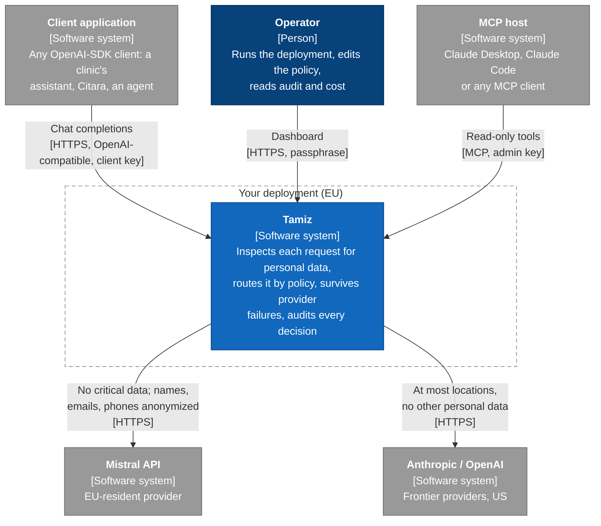
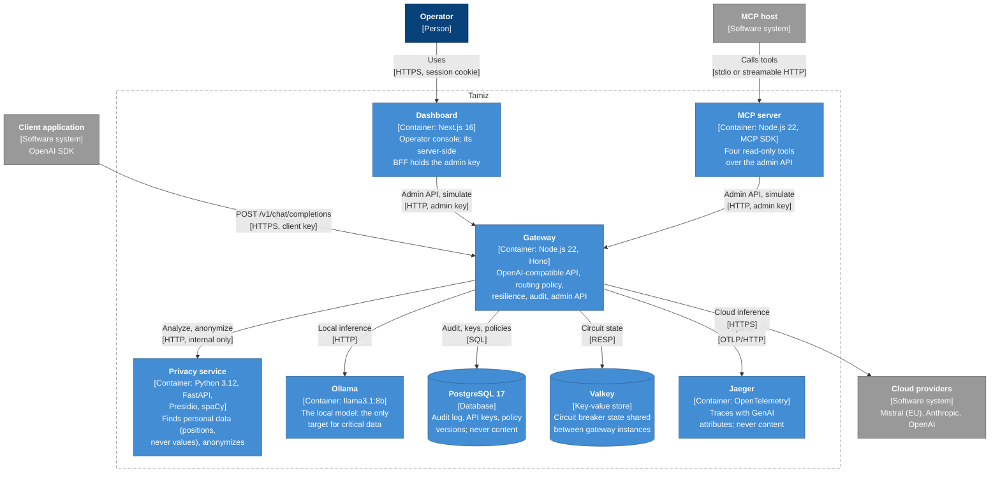
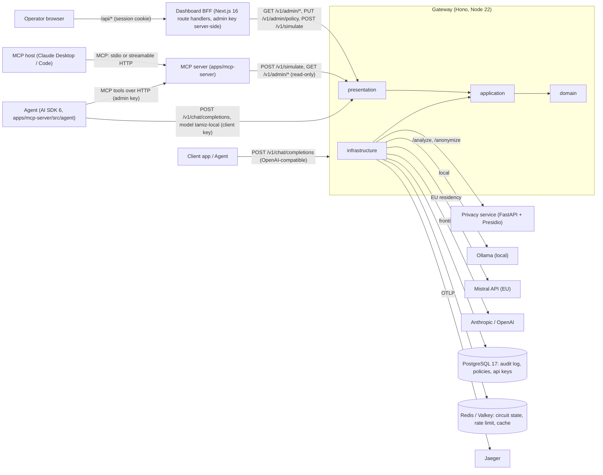
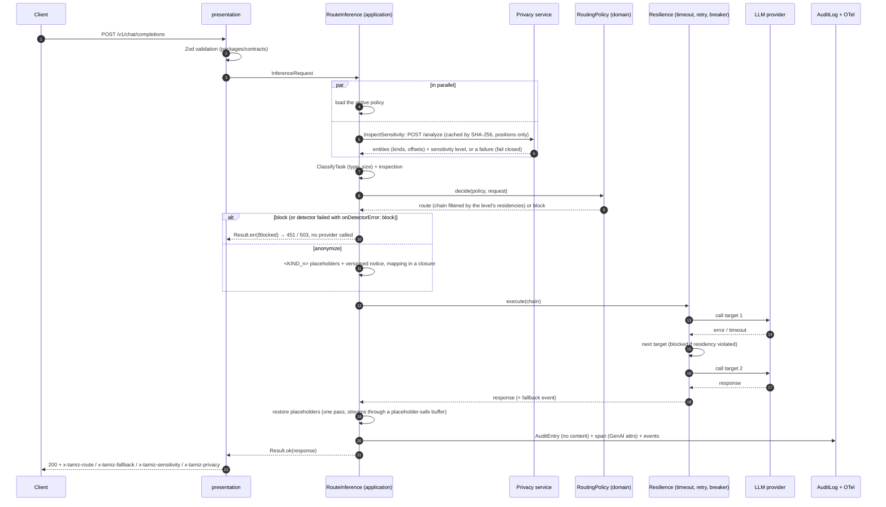
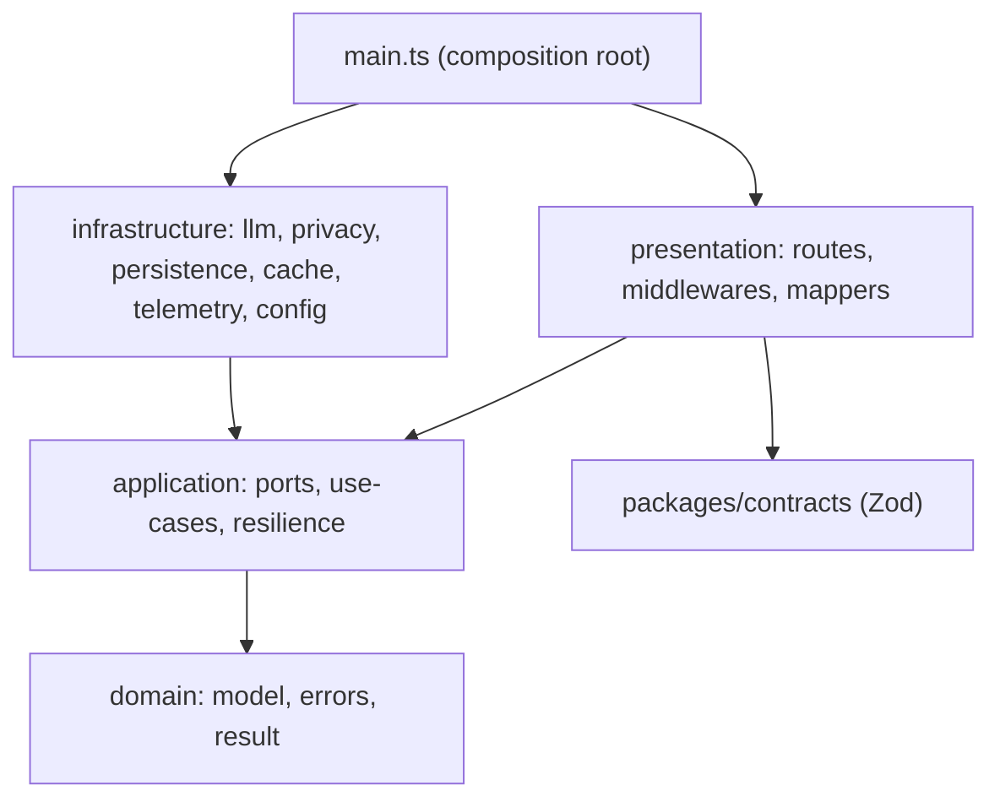
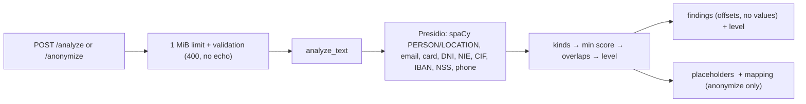
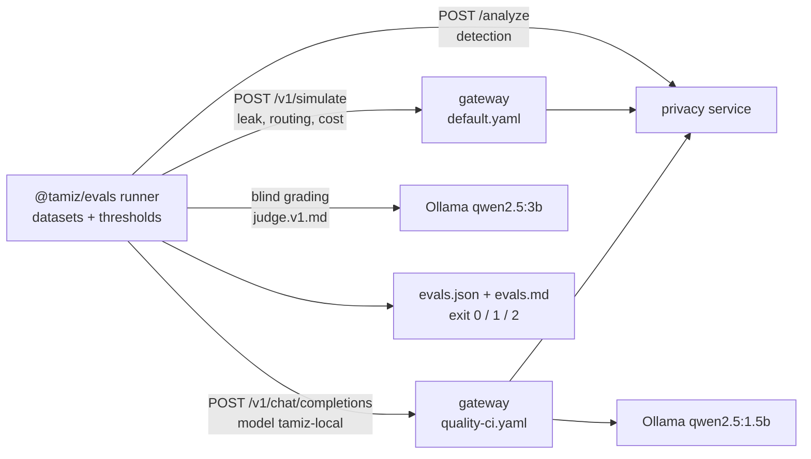

# Tamiz — Architecture

Diagrams for the system context and containers (C4), the system view, the request flow
and the gateway layers. The narrative and rationale live in `docs/tamiz-project.md`
section 4 and in `docs/adr/`.

## C4: system context

Who uses Tamiz and which outside systems it talks to (C4 level 1, drawn as a flowchart
because Mermaid's C4 layout overlaps its labels). Personal data crosses only the
boundaries the routing policy allows. Critical data never leaves the deployment. Names,
emails and phones leave only anonymized, and only to EU-resident providers. Locations
(low sensitivity) may go anywhere. These are the rules of `policies/default.yaml`; a
policy can be stricter.



## C4: containers

What runs inside a deployment (C4 level 2): the services of `docker-compose.yml`, plus
the MCP server, which runs next to its host. Only the gateway, the dashboard and Jaeger's
UI are meant to be reachable from outside. The privacy service has no authentication and
stays on the internal network.



## System view



## Request flow



What exists after feature 003: validation, classification, `decide` with the allowed
residencies, and the resilient execution (`application/resilience/execute-chain.ts`:
residency guard → circuit breaker → retry → timeout → next target), for both completions
and streams, with `x-tamiz-route` / `x-tamiz-rule` / `x-tamiz-fallback`. Every step is a
`RoutingEvent` on the routing-events port, logged by default. Circuit state lives in
memory or, with `REDIS_URL`, in Valkey. The privacy service exists since feature 004 (below).
Since feature 005 the gateway calls it on every request (`application/use-cases/
inspect-sensitivity.ts`), applies the policy's privacy action in `decide`, anonymizes
and restores in `protect-messages.ts` / `restore-stream.ts`, and answers
`POST /v1/simulate` with the same steps minus the provider call.

Since feature 006 the use cases are wrapped, outermost first, by:

- **`withAudit` / `withAuditStream`** (`application/audit/with-audit.ts`). They write one
  content-free `AuditEntry` when the request ends (for a stream: the last part, an error
  part, or the client leaving). The entry goes to the bounded in-memory log or, with
  `DATABASE_URL`, to PostgreSQL through an asynchronous batched writer whose losses are
  `audit.dropped` events.
- **`withTracing` / `withTracingStream`** (`application/tracing/with-tracing.ts`). They
  open the `tamiz.request` span. `executeChain` runs each attempt in a `chat {model}`
  child span, and the routing events reach both the log and the active span (`fanOut`).

The admin API reads the same store:

- `GET /v1/admin/audit` (keyset pages);
- `GET /v1/admin/cost` (actual vs baseline);
- `GET /v1/admin/providers` (circuit state plus a window of the log).

| Concern | Port | Adapters |
|---|---|---|
| Audit write | `AuditLogPort` | in-memory ring buffer; async batched writer → PostgreSQL |
| Audit read, cost, provider window | `AuditReaderPort` | in-memory (pure aggregates); SQL (`percentile_cont`, `jsonb_array_elements`) |
| Spans | `TracerPort` | OpenTelemetry (OTLP/HTTP from `OTEL_*`), no-op by default |
| Routing events | `RoutingEventsPort` | pino log sink + OTel span-event sink, through `fanOut` |
| API keys | `StoredKeyLookup` (infrastructure) | environment (`TAMIZ_API_KEYS`, `TAMIZ_ADMIN_API_KEYS`) then PostgreSQL |

## Gateway layers and allowed dependencies



Rules enforced by `.dependency-cruiser.cjs` (feature 001):

| From | May import |
|---|---|
| `domain` | nothing |
| `application` | `domain` |
| `infrastructure` | `application`, `domain` |
| `presentation` | `application`, `domain`, `packages/contracts` |
| `main.ts` | everything (only place that imports `infrastructure`) |

## Privacy service layers

`services/privacy/src/privacy/{domain,application,infrastructure,api}/` mirrors the
gateway, enforced by import-linter (feature 004):

| Layer | Holds | May import |
|---|---|---|
| `domain` | entity kinds, findings, sensitivity rule, overlap resolution, placeholders, check characters | standard library only |
| `application` | `analyze_text`, `anonymize_text`, `PiiAnalyzerPort` | `domain` |
| `infrastructure` | Presidio engine with spaCy `es_core_news_lg`, the Spanish recognizers, settings | `application`, `domain` |
| `api` | FastAPI app, Pydantic contract (exported to `openapi.json`), errors, body limit, logging | `application`, `domain` |
| `main.py` | composition root: loads the model, then serves | everything |



Nothing is stored: no database, no files, no request content in logs (one allow-listed
JSON line per request; third-party loggers below WARNING are filtered out).

## Evals in CI (feature 007)

The `evals` job runs the evals against the real services, through their public contracts.
`packages/evals` imports no app code.



| Concern | Where |
|---|---|
| Datasets (synthetic, versioned) | `packages/evals/datasets/`; the PII ones are generated by `src/synthetic/generate.ts` |
| Thresholds | `packages/evals/src/thresholds.ts` |
| Quality baseline | `packages/evals/baselines/quality.json` |
| Report contract | `EvalReportSchema` in `packages/contracts/src/evals.ts` |
| README table | `pnpm evals:readme`, between `<!-- evals:start -->` markers |

## Dashboard

Organised by feature, routes stay thin. The browser only calls the dashboard's own `/api/*`
route handlers (the BFF): they check the session (and the origin, for writes), call the
gateway with the admin key held on the server, and parse every answer with the contract
schemas. Eval reports are read from a folder, not from the gateway (spec 008 R-09).

```
apps/dashboard/src/
├── app/                 routes only: (auth)/sign-in, (console)/*, api/* (the BFF)
├── features/            shell, shared, live-traffic, audit-log, policy-editor/{simulator,editor},
│                        cost-analytics, provider-health, eval-results
├── components/ui/       shadcn
└── lib/                 api-client.ts (browser), schemas.ts, server/ (env, session, gateway hc client)
```
