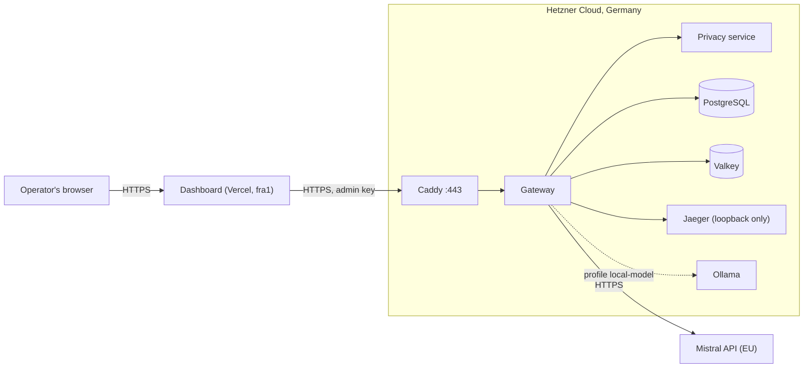

# Deploying the demo

Two ways to show Tamiz running:

- **Free: GitHub Codespaces** (`T-OPS-06`). Each visitor starts the full stack in their own
  codespace. Nothing is hosted, nothing is paid by the repository owner.
- **Hosted: a server and Vercel** (`T-OPS-02`). An always-on public demo, paid by whoever
  deploys it.

## Free demo: GitHub Codespaces

The button in the README opens the repository in a codespace on the visitor's own account.
GitHub's free Codespaces quota for personal accounts covers it: the 4-core machine it
asks for uses 4 core-hours of the quota per hour.

What the codespace does (`.devcontainer/`):

1. **On creation**, `setup.sh`:
   - installs pnpm;
   - runs `pnpm compose:env` with a generated passphrase, and keeps the passphrase and the
     two keys in `.devcontainer/credentials.txt` (git-ignored);
   - points the gateway at `policies/codespaces.yaml`;
   - starts the stack: the local stack of `docker-compose.yml`, with
     `docker-compose.codespaces.yml` on top for the dashboard's forwarded address and
     `qwen2.5:1.5b` instead of `llama3.1:8b`. This takes about 10 minutes (image builds and
     the model download);
   - writes `.env` last, so later `docker compose` commands use the overlay too.
2. **On each later start**, `start.sh` runs `docker compose up -d --build`. Codespaces may
   run it on creation while `setup.sh` is still running; without `.env` it does nothing.
3. **On attach**, `welcome.sh` prints the dashboard's address and the credentials.

The forwarded ports are private: only the codespace's owner, signed in to GitHub, reaches
the dashboard (3100), the gateway (3000) and Jaeger (16686).

Try it, in the codespace's terminal once `docker compose ps` shows the gateway healthy:

```bash
curl -s localhost:3000/v1/chat/completions \
  -H "authorization: Bearer <client key>" -H "content-type: application/json" \
  -d '{"model":"tamiz-auto","messages":[{"role":"user","content":"Resume el expediente de 12345678Z."}]}'
```

The answer comes from `ollama-qwen`, and the dashboard shows the request in live traffic
and the audit log.

Limits of this demo:

- **It runs only while the codespace runs.** Codespaces stop after 30 minutes idle by
  default. Delete the codespace when done: its disk (about 10 GB with the images) counts
  against the storage quota.
- **The model is small.** `qwen2.5:1.5b` answers in seconds on 4 cores, with the quality of
  a 1.5B model. Routing, privacy and audit behave as in any other deployment.

## Hosted demo: a server and Vercel

How to run an always-on public Tamiz demo (`T-OPS-02`). It costs money: the server, and
the Mistral credit its EU route uses. The layout:

- **The dashboard** runs on Vercel, region `fra1` (Frankfurt).
- **The gateway and everything it uses** run on a Hetzner Cloud server in Germany,
  behind Caddy with a Let's Encrypt certificate.
- **The only public entry to the server** is HTTPS on the gateway. Every request on it
  needs a Tamiz API key.



The server runs `docker-compose.yml` with `docker-compose.demo.yml` on top. Compared with
the local stack, the overlay:

- publishes only Caddy (ports 80 and 443);
- binds Jaeger's UI to the server's loopback, for an SSH tunnel;
- takes the Postgres password from the server's `.env`;
- leaves the dashboard out (it is on Vercel);
- puts Ollama behind the `local-model` profile.

The gateway runs `policies/demo-eu.yaml`: Mistral in the EU and the local model, no US
provider.

## 1. Choose the server

| Demo | RAM | What runs |
|---|---|---|
| EU route only | 8 GB | Gateway, privacy service (spaCy's large Spanish model alone needs about 1.5 GB), Postgres, Valkey, Jaeger, Caddy |
| EU route + local model | 16 GB | All of the above plus Ollama with `llama3.1:8b` |

- **Type:** a shared-vCPU x86 server of Hetzner's CX or CPX lines with that RAM. Check
  the current prices in the Hetzner Cloud console.
- **Location:** Falkenstein (`fsn1`) or Nuremberg (`nbg1`).
- **Image:** Ubuntu 24.04.
- **Access:** add your SSH key when you create the server.
- **CPU and the local model:** on CPU, `llama3.1:8b` takes 10 to 30 s per answer. The
  simulator never calls a model, so it is instant either way.

Hetzner Cloud firewall (attach it to the server):

| Direction | Port | Source |
|---|---|---|
| In | 22/tcp | Your IP only |
| In | 80/tcp, 443/tcp | Any |

Docker writes its own iptables rules and bypasses `ufw`. That is why the overlay publishes
nothing but Caddy: the Hetzner firewall and the overlay together are the protection, not
`ufw`.

## 2. Name

The gateway needs a host name for its certificate:

- **With your own domain:** an `A` record (and `AAAA` for IPv6), for example
  `gateway.example.com` → the server's IP.
- **Without a domain:** `<ip-with-dashes>.sslip.io` (for example
  `203-0-113-10.sslip.io`) resolves to the IP, and Let's Encrypt issues certificates for
  it. Let's Encrypt's rate limits are shared by everyone using sslip.io, so use your own
  domain if the first certificate fails.

## 3. Secrets

Generate them on your own machine, never on the server:

```bash
pnpm compose:env   # asks for the dashboard passphrase; prints the `demo` client key and the `ops` admin key once
```

1. Keep the two printed keys in your password manager.
2. In `apps/gateway/.env.docker`:
   - set `TAMIZ_POLICY_FILE=policies/demo-eu.yaml`;
   - set `MISTRAL_API_KEY` to a key from the Mistral console. Give it a spending limit:
     every answer on the EU route is billed to it.
3. `apps/dashboard/.env.docker` holds the three dashboard secrets. They go to Vercel
   (step 5), not to the server.

## 4. Server

Install Docker Engine with the compose plugin, following Docker's guide for Ubuntu
(`docs.docker.com/engine/install/ubuntu`). Then:

```bash
git clone https://github.com/AxelAxx/tamiz.git && cd tamiz
cat > .env <<EOF
COMPOSE_FILE=docker-compose.yml:docker-compose.demo.yml
TAMIZ_DEMO_DOMAIN=gateway.example.com
TAMIZ_POSTGRES_PASSWORD=$(openssl rand -hex 24)
EOF
chmod 600 .env
```

From your machine, copy the gateway secrets:

```bash
scp apps/gateway/.env.docker root@<server>:tamiz/apps/gateway/.env.docker
```

On the server:

```bash
chmod 600 apps/gateway/.env.docker
docker compose up -d --build                         # EU route only
# or: docker compose --profile local-model up -d --build   (16 GB; downloads about 5 GB once)
```

The first build takes several minutes, mostly the privacy image. Check the server from
your own machine:

```bash
curl -s https://gateway.example.com/health
curl -s https://gateway.example.com/v1/simulate \
  -H "authorization: Bearer <ops key>" -H "content-type: application/json" \
  -d '{"model":"tamiz-auto","messages":[{"role":"user","content":"Resume el expediente de 12345678Z."}]}'
```

The simulation should say `"sensitivity":"critical"` and
`"privacyAction":"restrict_to_local"`. Without a key, every `/v1/*` path answers `401`.

## 5. Dashboard on Vercel

1. Import the GitHub repository into Vercel and set **Root Directory** to
   `apps/dashboard`. `apps/dashboard/vercel.json` sets:
   - the framework;
   - the install (pnpm, the workspace lockfile);
   - the build, which runs Turborepo from the repository root so `@tamiz/contracts` is
     built first;
   - the region, `fra1`.
2. Environment variables (Production):

   | Variable | Value |
   |---|---|
   | `TAMIZ_GATEWAY_URL` | `https://gateway.example.com` |
   | `TAMIZ_DASHBOARD_ADMIN_KEY` | from `apps/dashboard/.env.docker` |
   | `TAMIZ_DASHBOARD_PASSPHRASE_HASH` | from `apps/dashboard/.env.docker` (paste it as is: Vercel does not expand `$`) |
   | `TAMIZ_DASHBOARD_SESSION_SECRET` | from `apps/dashboard/.env.docker` |
   | `TAMIZ_DASHBOARD_PUBLIC_URL` | the production URL, for example `https://tamiz.vercel.app` |
   | `TAMIZ_DASHBOARD_TRUST_PROXY` | `true` (Vercel sets `X-Forwarded-For` itself) |
   | `TAMIZ_DASHBOARD_VISITOR_ACCESS` | `true` for a public demo (section 6), else leave it out |

3. Deploy. Open the URL and sign in with the passphrase. Then check:
   - the simulator decides as in step 4;
   - the evals screen shows the bundled reports;
   - live traffic shows the requests you send with the `demo` key.
   - moving between screens for a few minutes never sends you back to sign-in (sessions
     are signed cookies that every instance accepts, `T-OPS-04`).

If a variable is missing or malformed, the deployment's function logs list it.

## 6. Who gets in

The dashboard is an operator console. The passphrase opens every screen: audit, cost,
provider health, and the policy editor, which saves new policy versions that the gateway
uses at once.

**Visitors** (`TAMIZ_DASHBOARD_VISITOR_ACCESS=true`, `T-OPS-03`): the sign-in page also
offers "Explore as a visitor". A visitor session can read every screen and run the
simulator, at most 10 simulations a minute per address; the policy is shown read-only and
a save is refused with `403`. At most 10 visitor sessions a minute are opened per address.
Simulations call the privacy service but no model, so a visitor spends no Mistral credit.
This is the setting to link from the README.

For the operator:

- **Do not publish the passphrase.** Share it on request, and change it afterwards:
  1. run `pnpm --filter @tamiz/dashboard hash-passphrase`;
  2. put the result in the Vercel variable;
  3. redeploy.
- **Do not publish the `demo` client key.** Every request with it can cost money on the
  Mistral key. For a public "try it" experience, use the GIF and the README's quick
  start instead.

## 7. Operating it

| Task | How |
|---|---|
| Update | `git pull && docker compose up -d --build` on the server; Vercel redeploys on push to `main` |
| Traces | `ssh -L 16686:127.0.0.1:16686 root@<server>`, then http://localhost:16686 |
| Logs | `docker compose logs -f gateway` (never prompt content: constitution V) |
| Rotate a key | `pnpm --filter @tamiz/gateway generate-api-key <client>` locally, replace the hash in `apps/gateway/.env.docker` on the server, `docker compose up -d gateway` |
| Revoke a stored key | From a checkout that reaches the database: `DATABASE_URL=… pnpm --filter @tamiz/gateway api-key:revoke <key>` (keys added with `api-key:add`; the row stays, marked revoked). Keys in `TAMIZ_API_KEYS` are removed from that variable instead |
| Health | `curl -s https://gateway.example.com/health`: `checks` names each dependency; 503 when the privacy service or the database is down |
| Reset the policy | `docker compose down -v` drops the policy versions and the audit log, along with the other volumes (demo data only) |

## Limitations of the demo

- **No request rate limit in the gateway.** A leaked client key can spend the Mistral
  budget until it is rotated. The spending limit on the Mistral key is the backstop.
- **The sign-in rate limit and the visitor limits are per serverless instance on
  Vercel**, so they are weaker than on a single server.
- **Sign-out on Vercel ends the session in that browser, not everywhere.** Sessions are
  signed cookies (`T-OPS-04`), so any instance accepts them, and the dashboard needs no
  shared store. Sign-out clears the cookie, but a copy of it made before then is refused
  only by the instance that handled the sign-out; others accept it until it expires (at
  most 8 hours). To end every session at once, change `TAMIZ_DASHBOARD_SESSION_SECRET`
  and redeploy.
- **The local model is slow on CPU.** On an 8 GB server there is none, and requests that
  must stay local fail. They are audited as failed, and the simulator still shows the
  decision.
- **The evals screen shows the reports bundled in `apps/dashboard/data/evals`** at deploy
  time, not live CI runs.
- **Demo data only.** Never send real personal data to the demo.
